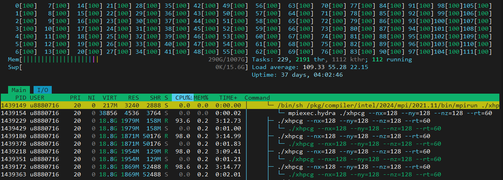

# Run HPCG with Intel OneAPI in F1 x86 cluster

[1. 事先準備](#1-事先準備)  
[2. 修改編譯文件與編譯](#2-修改編譯文件與編譯)  
[3. 執行運算](#3-執行運算)

## 1. 事先準備

1.1 Import Intel OneAPI module

```bash
[userA@ilgn01 hpcg]$ module purge
[userA@ilgn01 hpcg]$ module load intel/2024_01_46

[userA@ilgn01 hpcg]$ which mpicxx
/pkg/compiler/intel/2024/mpi/2021.11/bin/mpicxx
[userA@ilgn01 hpcg]$ which mpiicpc
/pkg/compiler/intel/2024/mpi/2021.11/bin/mpiicpc
```

1.2 Download HPCG source code

```bash
[userA@ilgn01 hpcg]$ git clone https://github.com/hpcg-benchmark/hpcg.git
[userA@ilgn01 hpcg]$ cd hpcg
```

## 2. 修改編譯文件與編譯

2.1 複製編譯文件

```bash
[userA@ilgn01 hpcg]$ cp setup/Make.Linux_MPI Make.Linux_MPI
```

2.2 修改部分的編譯文件Make.Linux_MPI，新增OpenMP與 VTune的參數。以下只列出要修改的部分。

```bash
MPdir        = $(I_MPI_ROOT)

HPCG_INCLUDES = -I$(INCdir) -I$(INCdir)/$(arch)

HPCG_OPTS     = -DHPCG_CONTIGUOUS_ARRAYS

CXX          = mpiicpc
CXXFLAGS     = $(HPCG_DEFS) \
               -O3 \
               -march=native \
               -mtune=native \
               -qopt-prefetch=3 \
               -qopt-mem-layout-trans=3 \
               -qopenmp \
               -g \
               -fno-omit-frame-pointer
```

**CXXFLAGS說明**

- `mpiicpc` - Intel MPI C++編譯器（自動包含MPI庫）
- `O3` - 最高級優化
- `march=native -mtune=native` - 針對CPU架構優化
- `qopt-prefetch=3` - 啟用積極預取
- `DHPCG_CONTIGUOUS_ARRAYS` - 連續數組分配，利於預取
- `qopenmp` - 啟用 Intel OpenMP
- `g` - 保留調試符號（VTune 需要）
- `fno-omit-frame-pointer` - 保留棧幀指針，VTune profiling 必需

  2.3 進行編譯

```bash
[userA@ilgn01 hpcg]$ make arch=Linux_MPI

# 編譯後的檔案在bin資料夾
[userA@ilgn01 hpcg]$ ls bin
hpcg.dat  xhpcg
```

## 3. 執行運算

進入bin路徑

```bash
[userA@ilgn01 hpcg]$ cd bin
```

3.1 編譯Slurm腳本run.slurm

```bash
#!/bin/bash
#SBATCH --account=GOV109092        # (-A) iService Project ID
#SBATCH --job-name=2x112             # (-J) Job name
#SBATCH --partition=development    # (-p) Slurm partition development, ct112, ct448
#SBATCH --nodes=2                  # (-N) Maximum number of nodes to be allocated
#SBATCH --ntasks-per-node=112      # Maximum number of tasks on each node 112
#SBATCH --cpus-per-task=1          # (-c) Number of cores per MPI task
##SBATCH --time=00:30:00           # (-t) Wall time limit (days-hrs:min:sec)
#SBATCH --output=%x_%j.out         # (-o) Path to the standard output file

echo "SLURM_NODELIST=$SLURM_NODELIST"
echo "SLURM_NNODES=$SLURM_NNODES"
echo "SLURM_NTASKS_PER_NODE=$SLURM_NTASKS_PER_NODE"
echo "SLURM_CPUS_PER_TASK=$SLURM_CPUS_PER_TASK"

module purge
module load intel

echo -e "\n ===== Only use OpenMPI ======\n"
# 1. 進程綁定（核心）
export I_MPI_PIN=1           ; echo "I_MPI_PIN=1"
export I_MPI_PIN_DOMAIN=core ; echo "I_MPI_PIN_DOMAIN=core"

# 2. 通信協議選擇
export I_MPI_FABRICS=shm:ofi ; echo "I_MPI_FABRICS=$I_MPI_FABRICS"

export OMP_NUM_THREADS=1 ; echo "OMP_NUM_THREADS=$OMP_NUM_THREADS"

SECONDS=0
mpirun ./xhpcg --nx=128 --ny=128 --nz=128 --rt=60

# 合併結果到日誌
{
    echo "=== HPCG Results ==="
    cat hpcg*.txt 2>/dev/null
    cat HPCG-Benchmark_*.txt 2>/dev/null
    rm -f HPCG-Benchmark_*.txt hpcg*.txt  # 刪除原始文件
} >> ${SLURM_JOB_NAME}_${SLURM_JOBID}.out

RUNTIME=$SECONDS
HOUR=$(($RUNTIME / 3600)) ;MIN=$(((RUNTIME /60)%60)) ;SEC=$((RUNTIME % 60))
echo -e "\n Job Done! Runtime:$HOUR:$MIN:$SEC\n"

```

環境變數說明

- I_MPI_PIN=1
  - 用途：啟用 Intel MPI 進程綁定（Process Pinning / CPU Affinity），將 MPI 進程固定在特定 CPU 上，防止作業系統在執行中頻繁切換核心導致快取失效。

- I_MPI_PIN_DOMAIN=core
  - 用途：定義綁定範圍。設定為 core 表示以「實體核心」為單位分配進程，避免分配在同一個實體核心的超執行緒（Hyper-Threading）上而互相爭奪算力。

- I_MPI_FABRICS=shm:ofi
  - 用途：指定跨進程通訊網路協議。
  - shm（Shared Memory）：同節點內的 MPI 通訊直接走記憶體共享，延遲極低。
  - ofi（Open Fabrics Interfaces）：跨節點通訊走 OFI/libfabric 介面（支援 InfiniBand 或高速網路）。
- OMP_NUM_THREADS=$SLURM_CPUS_PER_TASK
  - 用途：設定每個 MPI 進程產生的 OpenMP 執行緒數。腳本中等於 1，代表純 MPI 模式或每個 MPI 進程只使用 1 個 OpenMP 執行緒。

    3.2 執行運算

```bash
[userA@ilgn01 hpcg]$ sbatch run.slurm
Submitted batch job 65460
[userA@ilgn01 bin]$ squeue -u $USER
             JOBID PARTITION     NAME     USER ST       TIME  NODES NODELIST(REASON)
             65460 developme     hpcg userA  R       0:14      1 icpnp322

# 進入計算節點，查看計算效率
[userA@ilgn01 bin]$ ssh icpnp322
[userA@icpnp322 ~]$ htop
```


