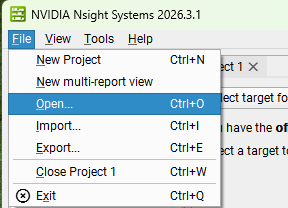
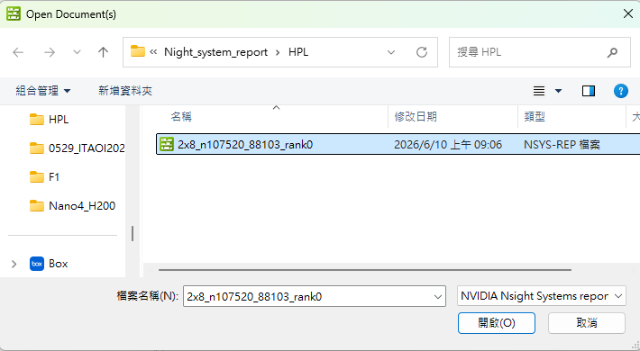
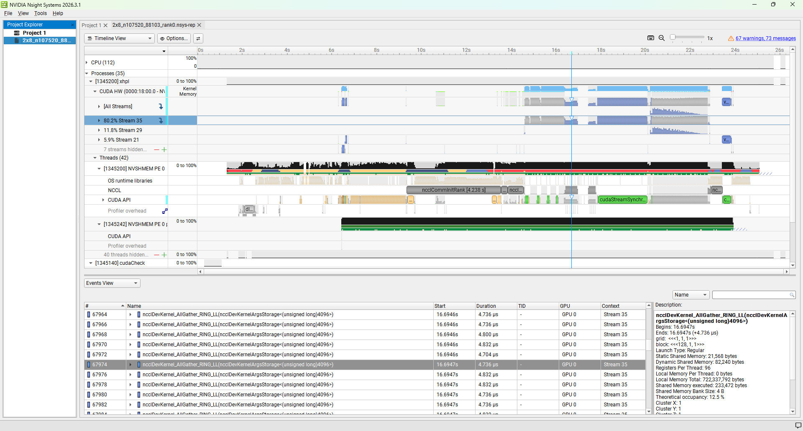
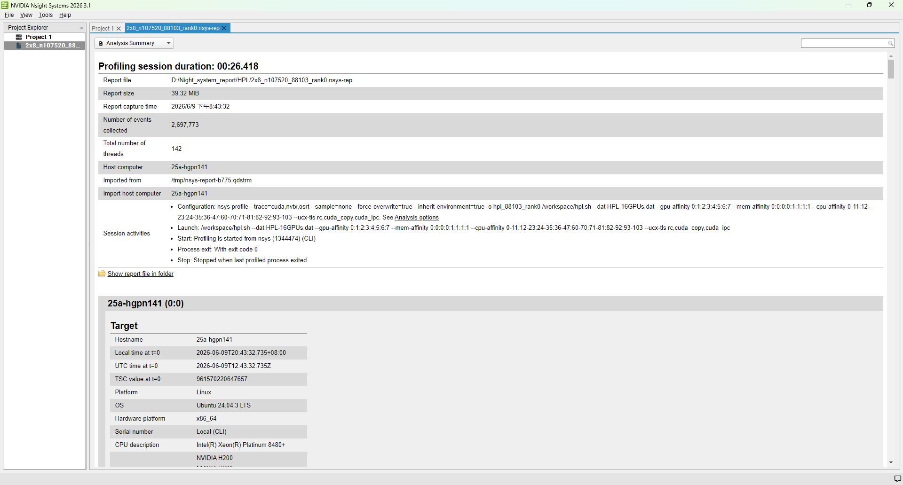

# Run HPL(Nvidia HPC Benchmarks container) on Nano4 H200 GPU cluster

本文採用[Nvidia HPC-Benchmarks容器](https://catalog.ngc.nvidia.com/orgs/nvidia/containers/hpc-benchmarks)進行HPL運算。

[1. 事先準備](#1-事先準備)  
[2. 編輯Slurm script與提交任務](#2-編輯slurm-script與提交任務)  
[3. 用Nsight Systems進行剖析](#3-用nsight-systems進行剖析)

## 1. 事先準備

1. 用Singularity下載Nvidia NGC container image

   `singularity pull docker://nvcr.io/nvidia/hpc-benchmarks:25.09`

2. 新增資料夾hpc-benchmark與進入資料夾

   ```bash
   mkdir hpc-benchmark
   cd ~/hpc_benchmark
   ```

3. 查看容器內HPL相關檔案與複製檔案

   ```bash
   [user@25a-lgn05 hpc_benchmark]$ singularity shell /work/$(whoami)/sif/hpc-benchmarks_25.09.sif
   Apptainer> ls /workspace
   NVIDIA_Deep_Learning_Container_License.pdf  hpcg.sh           hpl-mxp-linux-x86_64  hpl.sh                   stream-gpu-test.sh
   hpcg-linux-x86_64                           hpl-linux-x86_64  hpl-mxp.sh            stream-gpu-linux-x86_64  third_party.txt

   # 查看HPL相關檔案
   Apptainer> ls /workspace/hpl-linux-x86_64
   COPYRIGHT-HPL-2.1  README  RUNNING  TUNING  hpl.sh  sample-dat  sample-slurm  xhpl

   # 查看輸入檔
   Apptainer> ls /workspace/hpl-linux-x86_64/sample-dat
   HPL-1024GPUs.dat      HPL-B200-512GPUs.dat          HPL-B200-OOC-4GPUs.dat         HPL-GB200-OOC-8GPUs.dat  HPL-OOC-16GPUs.dat
   HPL-128GPUs.dat       HPL-B200-64GPUs.dat           HPL-B200-OOC-64GPUs.dat        HPL-GH-128GPUs.dat       HPL-OOC-1GPU.dat
   HPL-16GPUs.dat        HPL-B200-8GPUs.dat            HPL-B200-OOC-8GPUs.dat         HPL-GH-16GPUs.dat        HPL-OOC-2GPUs.dat
   ...

   # 查看Slurm script
   Apptainer> ls /workspace/hpl-linux-x86_64/sample-slurm
   hpl-enroot-1N.sub  hpl-enroot-8N.sub  hpl-singularity-1N.sub  hpl-singularity-8N.sub

   # 複製輸入檔到host端
   Singularity> cp /workspace/hpl-linux-x86_64/sample-dat/HPL-16GPUs.dat HPL-16GPUs.dat
   # 離開容器
   Singularity> exit
   Apptainer> cp /workspace/hpl-linux-x86_64/sample-dat/HPL-16GPUs.dat HPL-16GPUs.dat
   exit
   [user@25a-lgn05 hpc_benchmark]$ ls
   HPL-16GPUs.dat
   ```

## 2. 編輯Slurm script與提交任務

使用兩個GPU節點，每個節點有8張 Nvidia H200 GPU 與8個tasks，每個task有12個cpu cores，導入NUMA與UCX參數。執行檔在容器內部`/workspace/hpl.sh`。

hpl.slurm

```bash
#!/bin/bash
#SBATCH -A <ProjectID>        # iService Project id
#SBATCH -J hpl                # job name
#SBATCH -p 16gpus             # partition dev normal normal2
#SBATCH -N 2                  # Maximum number of nodes to be allocated
#SBATCH --ntasks-per-node=8   # Number of MPI tasks (i.e. processes)
#SBATCH --cpus-per-task=12    # Number of cores per MPI task
#SBATCH --gres=gpu:8
#SBATCH -o %x_%j.out          # Path to the standard output file

module purge
module load gcc/11.5 openmpi/5.0.10-cuda13.0 # for multi-nodes

export UCX_POSIX_USE_PROC_LINK=n ; echo "UCX_POSIX_USE_PROC_LINK=n" # disable UCX error message

RUN=(
    srun --mpi=pmi2
    -N $SLURM_NNODES
    --ntasks-per-node=$SLURM_NTASKS_PER_NODE
    --cpu-bind=none
    --mem-bind=none
    singularity exec --nv /work/$(whoami)/sif/hpc-benchmarks_25.09.sif
    /workspace/hpl.sh
    --dat HPL-16GPUs.dat
    --gpu-affinity 0:1:2:3:4:5:6:7
    --mem-affinity 0:0:0:0:1:1:1:1
    --cpu-affinity 0-11:12-23:24-35:36-47:60-70:71-81:82-92:93-103
    --ucx-affinity mlx5_0:mlx5_3:mlx5_4:mlx5_5:mlx5_6:mlx5_7:mlx5_8:mlx5_9
    --ucx-tls rc,cuda_copy,cuda_ipc
)
echo "${RUN[*]}" ; "${RUN[@]}"
```

從容器複製的HPL-16GPU.dat，修改其參數

```bash
HPLinpack benchmark input file
Innovative Computing Laboratory, University of Tennessee
HPL.out      output file name (if any)
6            device out (6=stdout,7=stderr,file)
1            # of problems sizes (N)
102400       Ns
1            # of NBs
1024         NBs
1            PMAP process mapping (0=Row-,1=Column-major)
1            # of process grids (P x Q)
4            Ps
4            Qs
16.0         threshold
1            # of panel fact
0            PFACTs (0=left, 1=Crout, 2=Right)
1            # of recursive stopping criterium
2            NBMINs (>= 1)
1            # of panels in recursion
2            NDIVs
1            # of recursive panel fact.
0            RFACTs (0=left, 1=Crout, 2=Right)
1            # of broadcast
3            BCASTs (0=1rg,1=1rM,2=2rg,3=2rM,4=Lng,5=LnM)
1            # of lookahead depth
1            DEPTHs (>=0)
1            SWAP (0=bin-exch,1=long,2=mix)
192          swapping threshold
1            L1 in (0=transposed,1=no-transposed) form
0            U  in (0=transposed,1=no-transposed) form
0            Equilibration (0=no,1=yes)
8            memory alignment in double (> 0)
```

提交任務 `sbatch hpl.slurm`

觀看結果，測試結果如下

```bash
================================================================================
T/V                N    NB     P     Q         Time          Gflops (   per GPU)
--------------------------------------------------------------------------------
WC0           102400  1024     4     4         2.56       x.xxxe+0? (  x.xxxe+0?)

HPL_pdgesv() start time Wed Jun 10 14:52:51 2026
HPL_pdgesv() end time   Wed Jun 10 14:52:54 2026

--------------------------------------------------------------------------------
||Ax-b||_oo/(eps*(||A||_oo*||x||_oo+||b||_oo)*N)=   0.000305313177 ...... PASSED
||Ax-b||_oo  . . . . . . . . . . . . . . . . . = 0.0000000020053722
||A||_oo . . . . . . . . . . . . . . . . . . . = 25799.4194455345059396
||x||_oo . . . . . . . . . . . . . . . . . . . = 22.3938593698157931
||b||_oo . . . . . . . . . . . . . . . . . . . = 0.4999981795080811
================================================================================

Finished      1 tests with the following results:
              1 tests completed and passed residual checks,
              0 tests completed and failed residual checks,
              0 tests skipped because of illegal input values.
--------------------------------------------------------------------------------
```

## 3. 用Nsight Systems進行剖析

容器內的 hpl.sh 腳本只能用--ucx-affinity控制UCX層，無法控制NCCL與NVSHMEM，因此要強制NCCL與NVSHMEM只能讀取--ucx-affinity的八張網卡。

hpl_nsys.slurm

```bash
#!/bin/bash
#SBATCH -A <ProjectID>        # iService Project id
#SBATCH -J hpl                # job name
#SBATCH -p 16gpus             # partition dev normal normal2
#SBATCH -N 2                  # Maximum number of nodes to be allocated
#SBATCH --ntasks-per-node=8   # Number of MPI tasks (i.e. processes)
#SBATCH --cpus-per-task=12    # Number of cores per MPI task
#SBATCH --gres=gpu:8
#SBATCH --exclusive
#SBATCH -o %x_%j.out          # Path to the standard output file


module purge
module load gcc/11.5 openmpi/5.0.10-cuda13.0 # for multi-nodes

export UCX_POSIX_USE_PROC_LINK=n ; echo "UCX_POSIX_USE_PROC_LINK=n" # disable UCX error message

# 1. 指定真正用於 GPU 加速計算的 8 張 IB 網卡 (注意是用逗號分隔)
export COMPUTE_HCAS="mlx5_0,mlx5_3,mlx5_4,mlx5_5,mlx5_6,mlx5_7,mlx5_8,mlx5_9"

# 強制 NCCL 與 NVSHMEM 只准使用這 8 張卡，絕對不准碰 mlx5_1 和 mlx5_2
export NCCL_IB_HCA=$COMPUTE_HCAS
export NVSHMEM_HCA_LIST=$COMPUTE_HCAS
export UCX_NET_DEVICES="mlx5_0:1,mlx5_3:1,mlx5_4:1,mlx5_5:1,mlx5_6:1,mlx5_7:1,mlx5_8:1,mlx5_9:1"

# 2. 指定控制訊號 (Out-of-band) 走正常的乙太網路 (bond0)
# 避免 MPI 或 NCCL 試圖在沒有 IP 的 IB 網卡上建立 TCP 連線而超時
export NCCL_SOCKET_IFNAME=bond0
export OMPI_MCA_btl_tcp_if_include=bond0
export OMPI_MCA_oob_tcp_if_include=bond0

RUN=(
    srun --mpi=pmi2
    -N $SLURM_NNODES
    --ntasks-per-node=$SLURM_NTASKS_PER_NODE
    --cpu-bind=none
    --mem-bind=none
    --wait=0
    singularity exec -B /work:/work -B $PWD:$PWD --pwd $PWD --nv /work/$(whoami)/sif/hpc-benchmarks_25.09.sif
    ./run_nsys.sh
    --dat HPL-16GPUs.dat
    --gpu-affinity 0:1:2:3:4:5:6:7
    --mem-affinity 0:0:0:0:1:1:1:1
    --cpu-affinity 0-11:12-23:24-35:36-47:60-70:71-81:82-92:93-103
    --ucx-tls rc,cuda_copy,cuda_ipc
)
echo "${RUN[*]}" ; "${RUN[@]}"
```

若剖析所有rank，會造成部分資源消耗在剖析，讓真正要分析的運算過程失真，因此只記錄單一rank的計算過程，以下剖析rank0的計算過程。

run_nsys.sh

```bash
#!/bin/bash
# 1. 建立「萬無一失」的 Rank 偵測機制 (依序檢查 PMIx, PMI2, OpenMPI, Slurm)
MY_RANK=${PMIX_RANK:-${PMI_RANK:-${OMPI_COMM_WORLD_RANK:-${SLURM_PROCID:-unknown}}}}

# 如果真的抓不到 Rank (極少數情況)，就安全退回一般執行模式
if [ "$MY_RANK" = "unknown" ]; then
    echo "Warning: Cannot detect MPI Rank. Running normally without nsys."
    /workspace/hpl.sh "$@"
    exit $?
fi

# 2. 只讓 Rank 0 執行 Profiling
if [ "$MY_RANK" -eq 0 ]; then
    echo "Rank 0 (ID: $MY_RANK): Running with nsys profile..."
    nsys profile \
        --trace=cuda,nvtx,osrt \
        --sample=none \
        --force-overwrite=true \
        --inherit-environment=true \
        -o "hpl_${SLURM_JOBID:-job}_rank${MY_RANK}" \
        /workspace/hpl.sh "$@"
else
    # 其他 rank 正常執行
    /workspace/hpl.sh "$@"
fi
```

完成運算後，產生`hpl_<JOBID>_rank.nsys-rep`的剖析檔案，傳回本地端電腦，用Nsight Systems開啟剖析檔案

1. 開啟檔案  
   
   
2. Timeline View，觀察各項API、Kernel與時間的關係
   

3. Summary，觀察Process, thread summary
   
