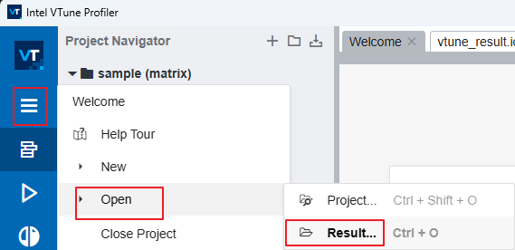
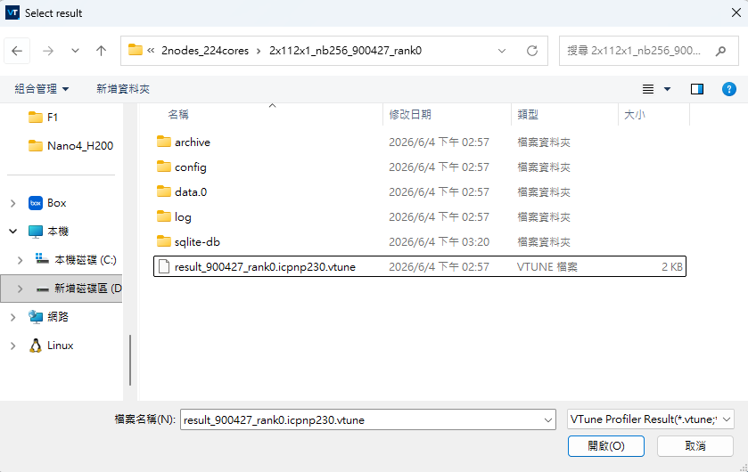
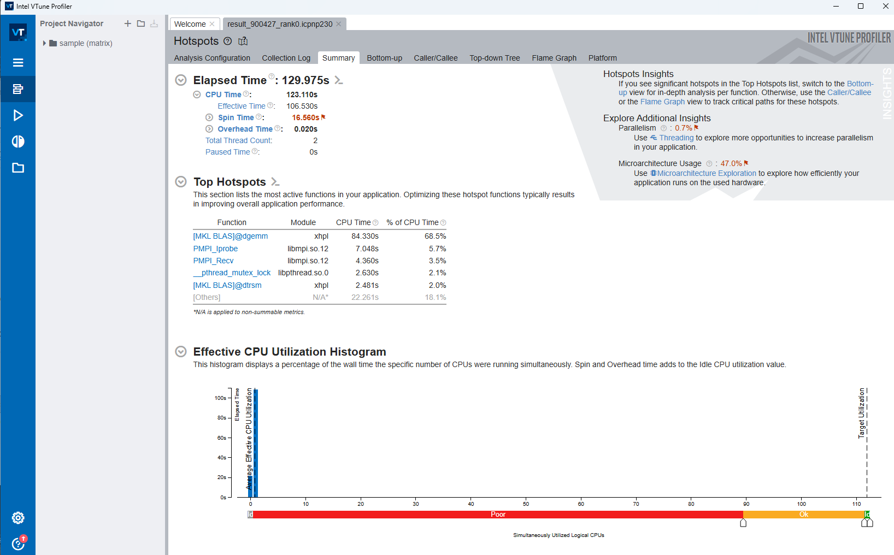
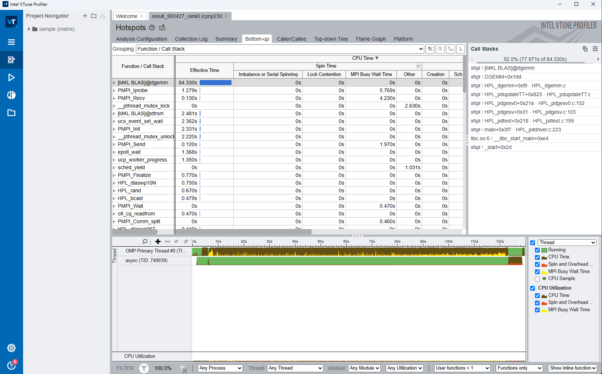
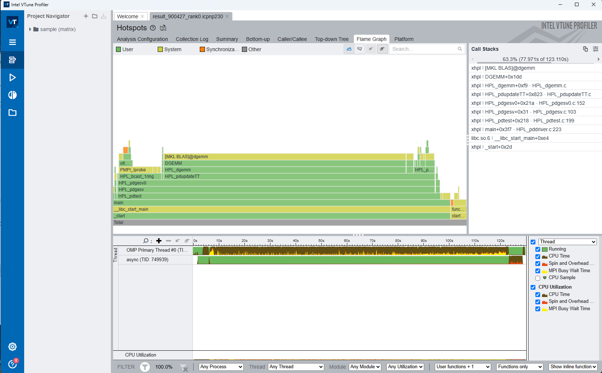

# Run Netlib HPL-2.3 with Intel OneAPI on Forerunner1

- [1. 事先準備](#1-事先準備)
- [2. 修改編譯文件](#2-修改編譯文件)
- [3. 編譯](#3-編譯)
- [4. 執行運算](#4-執行運算)
- [5. 用Intel Vtune進行剖析(Profiling)](#5-用intel-vtune進行剖析profiling)

## 1. 事先準備

1. 用Lmod取得Intel OneAPI

```bash
module purge
module load intel
```

2. 下載與解壓縮 Netlib HPL-2.3，進入資料夾

```bash
module purge
module load intel

# Download source code
wget https://netlib.org/benchmark/hpl/hpl-2.3.tar.gz
tar -zxvf hpl-2.3.tar.gz
rm -rf hpl-2.3.tar.gz

cd ~/hpl-2.3
```

## 2. 修改編譯文件

複製編譯文件`cp setup/Make.Linux_Intel64 .`

編輯編譯文件Make.Linux_Intel64，以下內容為需要修改的部分，其餘不須變動。

```bash
TOPdir       = $(HOME)/hpl-2.3

LAdir        = $(MKLROOT) # 因為您已經載入了 Intel 環境，系統會自動定義 $MKLROOT 變數
ifndef  LAinc
LAinc        = $(LAdir)/include
endif
ifndef  LAlib
LAlib        = -L$(LAdir)/lib/intel64 \
               -Wl,--start-group \
               $(LAdir)/lib/intel64/libmkl_intel_lp64.a \
               $(LAdir)/lib/intel64/libmkl_intel_thread.a \
               $(LAdir)/lib/intel64/libmkl_core.a \
               -Wl,--end-group -lpthread -ldl
endif

CC       = mpiicx # for new oneapi version
OMP_DEFS = -qopenmp # for new oneapi version

CCFLAGS  = $(HPL_DEFS) $(OMP_DEFS) -O3 -g -fno-omit-frame-pointer -w -fstrict-aliasing -Wall -fp-model=precise -fno-fast-math
```

**CCFLAGS的參數說明**

1. 因應新版Oneapi，相容 `icx`，CCFLAGS的參數如下：

   `CCFLAGS  = $(HPL_DEFS) -O3  -w -fstrict-aliasing -Wall`

2. 導入vtune profiling `-g -fno-omit-frame-pointer`
   - **`g` (生成除錯資訊)**：這是最重要的參數。它會在二進位檔案中加入符號表 (Symbol table)，讓 VTune 知道哪一段組合語言對應到 HPL 原始碼的哪一行。
   - **`fno-omit-frame-pointer` (保留堆疊指標)**：在極致最佳化下，編譯器通常會省略 Frame Pointer 以多逼出一個暫存器來用。但強制保留它可以讓 VTune 在進行 Hotspots 分析時，100% 準確地回溯 (Unwind) 函式呼叫的上下游關係，不會出現斷層。
   - **保留 `O3` (關鍵)**：**千萬不要**因為加上除錯參數就把最佳化降為 `O0`。您必須在 `O3` 的極致效能狀態下進行 Profiling，這樣抓出來的效能瓶頸才是真實環境下的瓶頸。

3. 導入openmp `$(OMP_DEFS)`

4. 強制要求 Intel 編譯器在浮點數運算上保持 IEEE 標準精確度，不要過度最佳化。`-fp-model=precise -fno-fast-math`

> [!note]  
> 解決新版OneAPI造成 `||Ax-b||_oo/(eps*(||A||_oo*||x||_oo+||b||_oo)*N)=    inf ... FAILED`  
> 在src/auxil/HPL_dlamch.c最上方（在任何 #include 之前），加入這一行指令 `#pragma clang optimize off`

## 3. 編譯

`make arch=Linux_Intel64`

若編譯錯誤，要清除 `make arch=Linux_Intel64 clean_arch_all`，再重新編譯

編譯完成的檔案在bin/Linux_Intel64/

## 4. 執行運算

編輯slurm 腳本 (run.slurm)
2 node , 112 ranks per node

```bash
#!/bin/bash
#SBATCH --account=<ProjectID>      # (-A) iService Project ID
#SBATCH --job-name=hpl             # (-J) Job name
#SBATCH --partition=development    # (-p) Slurm partition development, ct112, ct448
#SBATCH --nodes=2                  # (-N) Maximum number of nodes to be allocated
#SBATCH --ntasks-per-node=112      # Maximum number of tasks on each node 112
#SBATCH --cpus-per-task=1          # (-c) Number of cores per MPI task
#SBATCH --output=%x_%j.out         # (-o) Path to the standard output file

# 回傳SLURM環境變數
echo "SLURM_NNODES=$SLURM_NNODES"
echo "SLURM_NTASKS_PER_NODE=$SLURM_NTASKS_PER_NODE"
echo "SLURM_CPUS_PER_TASK=$SLURM_CPUS_PER_TASK"

# 啟用Intel OneAPI
module purge
module load intel

# 設定OpenMP thread數量，pure mpi is 1
export OMP_NUM_THREADS=$SLURM_CPUS_PER_TASK
export MKL_NUM_THREADS=$SLURM_CPUS_PER_TASK

# Intel MPI 最佳化環境變數
if [ "$SLURM_CPUS_PER_TASK" == "1" ]; then
    export I_MPI_PIN_DOMAIN=core  # 將每個 MPI 任務綁定到獨立的實體核心上
else
    export I_MPI_PIN_DOMAIN=omp # openmp
fi
echo "I_MPI_PIN_DOMAIN=$I_MPI_PIN_DOMAIN"

# 執行HPL運算
mpirun ./xhpl
```

HPL.dat

```bash
HPLinpack benchmark input file
Innovative Computing Laboratory, University of Tennessee
HPL.out      output file name (if any)
6            device out (6=stdout,7=stderr,file)
1            # of problems sizes (N)
10000        Ns
1            # of NBs
256          NBs
0            PMAP process mapping (0=Row-,1=Column-major)
1            # of process grids (P x Q)
14           Ps
16           Qs
16.0         threshold
1            # of panel fact
1            PFACTs (0=left, 1=Crout, 2=Right)
1            # of recursive stopping criterium
2            NBMINs (>= 1)
1            # of panels in recursion
2            NDIVs
1            # of recursive panel fact.
2            RFACTs (0=left, 1=Crout, 2=Right)
1            # of broadcast
0            BCASTs (0=1rg,1=1rM,2=2rg,3=2rM,4=Lng,5=LnM)
1            # of lookahead depth
0            DEPTHs (>=0)
2            SWAP (0=bin-exch,1=long,2=mix)
64           swapping threshold
0            L1 in (0=transposed,1=no-transposed) form
0            U  in (0=transposed,1=no-transposed) form
1            Equilibration (0=no,1=yes)
8            memory alignment in double (> 0)
```

提交任務 `sbatch run.slurm`

```bash
[USER@ilgn01 Linux_Intel64]$ sbatch run.slurm
Submitted batch job 905906
[USER@ilgn01 Linux_Intel64]$ ls
hpl_905906.out   HPL.dat  run.slurm  run_vtune.sh  xhpl
[USER@ilgn01 Linux_Intel64]$ head hpl_905906.out
SLURM_NNODES=2
SLURM_NTASKS_PER_NODE=112
SLURM_CPUS_PER_TASK=1
I_MPI_PIN_DOMAIN=core
================================================================================
HPLinpack 2.3  --  High-Performance Linpack benchmark  --   December 2, 2018
Written by A. Petitet and R. Clint Whaley,  Innovative Computing Laboratory, UTK
Modified by Piotr Luszczek, Innovative Computing Laboratory, UTK
Modified by Julien Langou, University of Colorado Denver
================================================================================
...
```

## 5. 用Intel Vtune進行剖析(Profiling)

VTune的指令如下：

`mpirun ... vtune -collect hotspots -result-dir vtune_result APP`

`-collect hotspots`是基礎的熱點剖析，vtune_result是收集剖析結果的資料夾

將執行運算的指令加入VTune參數

```bash
#mpirun ./xhpl
mpirun ./run_vtune.sh # checke single rank profiling
```

run_vtune.sh是剖析特定rank的腳本

```bash
#!/bin/bash
# 只有當 MPI Rank 為 0 時，才啟動 vtune，其餘直接執行程式
if [ "$PMI_RANK" == "0" ] || [ "$OMPI_COMM_WORLD_RANK" == "0" ]; then
    vtune -collect hotspots -result-dir result_${SLURM_JOBID}_rank0 ./xhpl
else
    ./xhpl
fi
```

設定run_vtune.sh可執行的權限 `chmod +x run_vtune.sh`

完成運算後，產生result\_<JOBID>\_rank0.<節點名稱>資料夾的剖析結果，傳回本地端電腦，用Intel VTune Profiler開啟剖析檔案

1. 開啟檔案  
   
   

2. 摘要，觀察Top Hotspots
   

3. Bottom-up，觀察最底層API計算時間
   

4. 火焰圖(Flame graph)，觀察API計算時間
   
