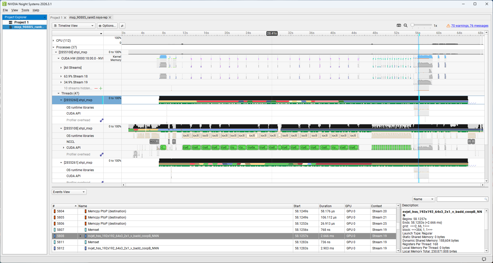

# Run HPL-MxP(Nvidia HPC-Benchmarks Container) on Nano4 H200 GPU cluster

[1. 事先準備](#1-事先準備)  
[2. 執行運算](#2-執行運算)  
[3. 用Nsight Systems剖析](#nsight-systems)

## 1. 事先準備

用Singularity下載Nvidia NGC container image

`singularity pull docker://nvcr.io/nvidia/hpc-benchmarks:25.09`

觀察與取得容器的檔案

```bash
[userA@25a-lgn01 hpc_benchmark]$ singularity shell --nv /work/$(whoami)/sif/hpc-benchmarks_25.09.sif
Apptainer> ls /workspace
hpc-benchmarks-gpu-env.sh  hpl-linux-x86_64      hpl.sh       microbenchmarks          stream-gpu-test.sh
hpcg-linux-x86_64          hpl-mxp-linux-x86_64  lib          source_code              third-party.txt
hpcg.sh                    hpl-mxp.sh            license.txt  stream-gpu-linux-x86_64
Apptainer> ls /workspace/hpl-mxp-linux-x86_64
COPYRIGHT-CLI11  README  RUNNING  TUNING  hpl-mxp.sh  sample-slurm  xhpl_mxp

# Slurm script
Apptainer> ls /workspace/hpl-mxp-linux-x86_64/sample-slurm
hpl-mxp-enroot-16N.sub  hpl-mxp-enroot-2N.sub   hpl-mxp-enroot-4N.sub   hpl-mxp-enroot-8N.sub       hpl-mxp-singularity-8N.sub
hpl-mxp-enroot-1N.sub   hpl-mxp-enroot-32N.sub  hpl-mxp-enroot-64N.sub  hpl-mxp-singularity-1N.sub
```

/workspace/hpl-mxp-linux-x86_64/RUNNING 是hpl-mxp.sh的參數說明

/workspace/hpl-mxp-linux-x86_64/TUNING 是./xhpl_mxp的參數說明

## 2. 執行運算

Slurm Script可以參考/workspace/hpl-mxp-linux-x86_64/sample-slurm/hpl-mxp-singularity-1N.sub

這裡示範用兩台H200 GPU節點，每台節點有8張 Nvidia H200 GPU 與8個tasks，每個task有12個cpu cores。

建立運算mxp.slurm

```bash
#!/bin/bash
#SBATCH -A <ProjectID>           # iService Project id
#SBATCH -J mxp                 # job name
#SBATCH -p 16gpus              # partition dev normal normal2
#SBATCH --nodes=2              # Maximum number of nodes to be allocated
#SBATCH --ntasks-per-node=8    # Number of MPI tasks (i.e. processes)
#SBATCH --cpus-per-task=12     # Number of cores per MPI task
#SBATCH --gres=gpu:8
#SBATCH -o %x_%j.out          # Path to the standard output file
#SBATCH -t 0-00:30:00

module purge
module load gcc/11.5 openmpi/5.0.10-cuda13.0 # for multi-nodes

sloppy_type=2 # FP16
RUN=(
    srun --mpi=pmi2
    -N $SLURM_NNODES
    --ntasks-per-node=$SLURM_NTASKS_PER_NODE
    --cpu-bind=none
    --mem-bind=none
    singularity exec --nv /work/$(whoami)/sif/hpc-benchmarks_25.09.sif
    /workspace/hpl-mxp.sh
    --gpu-affinity 0:1:2:3:4:5:6:7
    --mem-affinity 0:0:0:0:1:1:1:1
    --cpu-affinity 0-10:11-21:22-32:33-43:60-70:71-81:82-92:93-103
    --ucx-affinity mlx5_0:mlx5_3:mlx5_4:mlx5_5:mlx5_6:mlx5_7:mlx5_8:mlx5_9
    --n 102400 --nb 1024 --nprow 4 --npcol 4 --nporder row
    --preset-gemm-kernel 0 --u-panel-chunk-nbs 16 --use-mpi-panel-broadcast 50 --sloppy-type ${sloppy_type}
    --cuda-host-register-step 4096
    --call-dgemv-with-multiple-threads 0 --Anq-device 0 --mpi-use-mpi 1 --prioritize-trsm 0 --prioritize-factorization 1
)
echo "${RUN[*]}" ; "${RUN[@]}"

```

提交任務 `sbatch mxp.slurm`

察看結果

```bash
...
 ****** HPL MxP Result    ******

    EPS           . . . . . . . . . . . . . . . . .          =    2.000000E-16
    Threshold     . . . . . . . . . . . . . . . . .          =    1.600000E+01
  ||Ax-b||_oo     . . . . . . . . . . . . . . . . .          =    3.738871E-14
  ||A   ||_oo     . . . . . . . . . . . . . . . . .          =    1.032337E+05
  ||x   ||_oo     . . . . . . . . . . . . . . . . .          =    1.965817E-05
  ||b   ||_oo     . . . . . . . . . . . . . . . . .          =    9.999874E-01
  ||Ax-b||_oo / (EPS * (||A||_oo * ||x||_oo + ||b||_oo) * N) =    6.026399E-04 ...... PASSED

    N = 102400, NB = 1024, NPROW = 4, NPCOL = 4, SLOPPY-TYPE = FP16
       GFLOPS = x.xxxe+0?, per GPU =   xxxx.x ------ The HPL-MxP performance to report
    LU GFLOPS = x.xxxe+0?, per GPU =   xxxx.x ------ The performance excluding the iterative solver part

 ****** HPL MxP Result    ******

```

## 3. 用Nsight Systems剖析

<a id="nsight-systems"></a>

執行過程可參考[HPL](hpl_h200.md#用nsight-systems進行剖析)

mxp_nsys.slurm

```bash
#!/bin/bash
#SBATCH -A <ProjectID>           # iService Project id
#SBATCH -J mxp                # job name
#SBATCH -p 16gpus                # partition dev normal normal2
#SBATCH --nodes=2              # Maximum number of nodes to be allocated
#SBATCH --ntasks-per-node=8    # Number of MPI tasks (i.e. processes)
#SBATCH --cpus-per-task=12      # Number of cores per MPI task
#SBATCH --gres=gpu:8
#SBATCH -o %x_%j.out          # Path to the standard output file
#SBATCH -t 0-00:30:00

module purge
module load gcc/11.5 openmpi/5.0.10-cuda13.0 # for multi-nodes

# 1. 指定真正用於 GPU 加速計算的 8 張 IB 網卡 (注意是用逗號分隔)
export COMPUTE_HCAS="mlx5_0,mlx5_3,mlx5_4,mlx5_5,mlx5_6,mlx5_7,mlx5_8,mlx5_9"

# 強制 NCCL 與 NVSHMEM 只准使用這 8 張卡，絕對不准碰 mlx5_1 和 mlx5_2
export NCCL_IB_HCA=$COMPUTE_HCAS
export NVSHMEM_HCA_LIST=$COMPUTE_HCAS
export UCX_NET_DEVICES="mlx5_0:1,mlx5_3:1,mlx5_4:1,mlx5_5:1,mlx5_6:1,mlx5_7:1,mlx5_8:1,mlx5_9:1"

# 2. 指定控制訊號 (Out-of-band) 走正常的乙太網路 (bond0)
# 避免 MPI 或 NCCL 試圖在沒有 IP 的 IB 網卡上建立 TCP 連線而超時
export NCCL_SOCKET_IFNAME=bond0
export OMPI_MCA_btl_tcp_if_include=bond0
export OMPI_MCA_oob_tcp_if_include=bond0

export UCX_POSIX_USE_PROC_LINK=n ; echo "UCX_POSIX_USE_PROC_LINK=n" # disable UCX error message

sloppy_type=2
RUN=(
    srun --mpi=pmi2
    -N $SLURM_NNODES
    --ntasks-per-node=$SLURM_NTASKS_PER_NODE
    --cpu-bind=none
    --mem-bind=none
    --wait=0
    singularity exec --nv /work/$(whoami)/sif/hpc-benchmarks_25.09.sif
    ./run_mxp_nsys.sh
    --gpu-affinity 0:1:2:3:4:5:6:7
    --mem-affinity 0:0:0:0:1:1:1:1
    --cpu-affinity 0-10:11-21:22-32:33-43:60-70:71-81:82-92:93-103
    --ucx-affinity mlx5_0:mlx5_3:mlx5_4:mlx5_5:mlx5_6:mlx5_7:mlx5_8:mlx5_9
    --n 120400 --nb 1024 --nprow 4 --npcol 4 --nporder row
    --preset-gemm-kernel 0 --u-panel-chunk-nbs 16 --use-mpi-panel-broadcast 50 --sloppy-type ${sloppy_type}
    --cuda-host-register-step 4096
    --call-dgemv-with-multiple-threads 0 --Anq-device 0 --mpi-use-mpi 1 --prioritize-trsm 0 --prioritize-factorization 1
)
echo "${RUN[*]}" ; "${RUN[@]}"
```

run_mxp_nsys.sh

```bash
#!/bin/bash
# 1. 建立「萬無一失」的 Rank 偵測機制 (依序檢查 PMIx, PMI2, OpenMPI, Slurm)
MY_RANK=${PMIX_RANK:-${PMI_RANK:-${OMPI_COMM_WORLD_RANK:-${SLURM_PROCID:-unknown}}}}

# 如果真的抓不到 Rank (極少數情況)，就安全退回一般執行模式
if [ "$MY_RANK" = "unknown" ]; then
    echo "Warning: Cannot detect MPI Rank. Running normally without nsys."
    /workspace/hpl-mxp.sh "$@"
    exit $?
fi

# 2. 只讓 Rank 0 執行 Profiling
if [ "$MY_RANK" -eq 0 ]; then
    echo "Rank 0 (ID: $MY_RANK): Running with nsys profile..."
    nsys profile \
        --trace=cuda,nvtx,osrt \
        --sample=none \
        --force-overwrite=true \
        --inherit-environment=true \
        -o "mxp_${SLURM_JOBID:-job}_rank${MY_RANK}" \
        /workspace/hpl-mxp.sh "$@"
else
    # 其他 rank 正常執行
    /workspace/hpl-mxp.sh "$@"
fi
```

完成運算後，產生mxp\_<JOBID>\_rank0.nsys-rep的剖析結果，傳回本地端電腦，用Nsight Systems開啟剖析檔案


